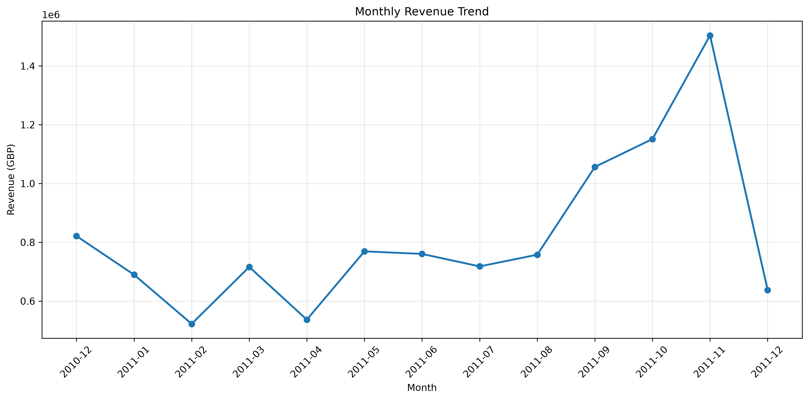
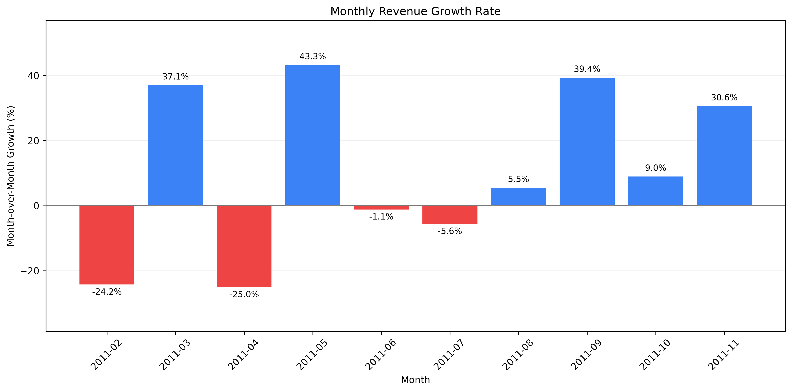
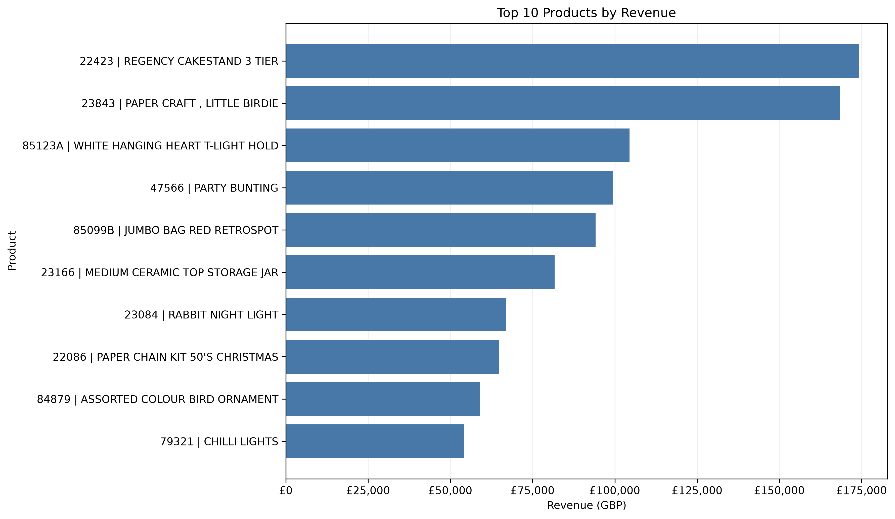
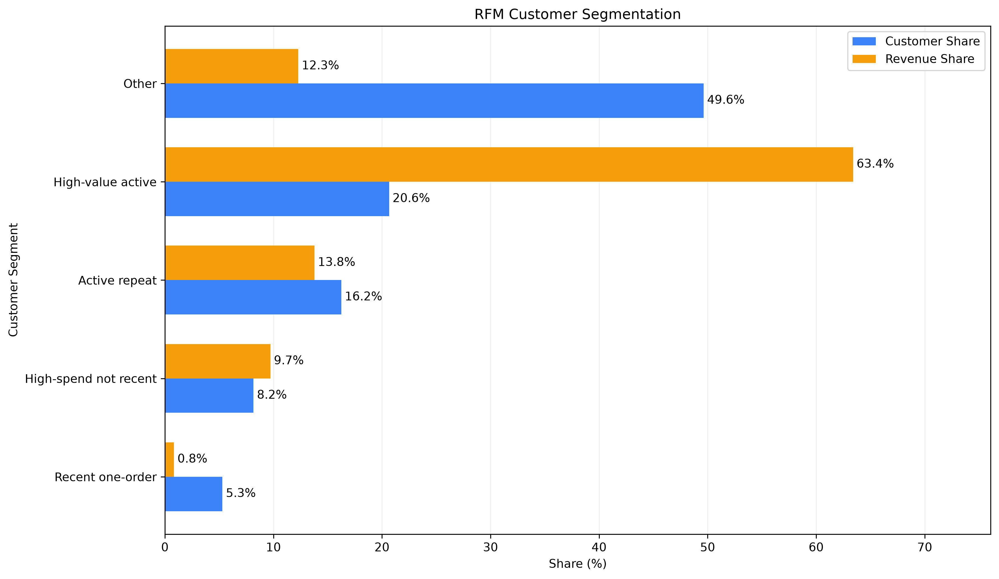

# E-commerce Sales & Customer Analytics
### 基于 Python、MySQL 和 RFM 模型的电商销售与客户价值分析

An end-to-end e-commerce analytics project covering data cleaning, SQL analysis, sales visualization, customer behavior analysis, and RFM segmentation.

## 1. Project Overview / 项目介绍

本项目基于英国在线零售商的真实交易数据，使用 Python 和 MySQL 构建从原始数据处理到业务洞察的完整分析流程。

The project analyzes real-world UK online retail transactions to uncover sales trends, identify top-performing products, examine purchasing behavior, and segment customers using the RFM model.

**Technology Stack / 技术栈**

- Python 3.12, Pandas, NumPy
- MySQL 8.4, SQLAlchemy, PyMySQL
- Matplotlib, Seaborn
- Git, GitHub, VS Code

## 2. Dataset / 数据来源

**Source:** [UCI Machine Learning Repository — Online Retail](https://archive.ics.uci.edu/dataset/352/online+retail)

- Original records / 原始记录：541,909
- Cleaned transaction lines / 清洗后交易明细：524,878
- Observation period / 数据时间范围：2010-12-01 to 2011-12-09
- Currency / 货币单位：GBP (£)

该数据集包含订单编号、商品编码、商品名称、购买数量、商品价格、交易日期、客户编号及国家信息。

This is a transaction-level dataset. It does not contain website browsing, add-to-cart, or clickstream events.

**Dataset citation:** Chen, D. (2015). *Online Retail*. UCI Machine Learning Repository. https://doi.org/10.24432/C5BW33

Dataset license: CC BY 4.0.

## 3. Key Business Metrics / 核心业务指标

| Metric / 指标 | Result / 结果 |
|---|---:|
| Cleaned Transaction Lines / 清洗后交易明细 | 524,878 |
| Positive Transaction Revenue / 正向交易销售额 | £10,642,110.80 |
| Unique Orders / 独立订单数 | 19,960 |
| Average Order Value / 平均订单金额 | £533.17 |
| Identified Customers / 可识别客户数 | 4,338 |
| Repeat Customers / 复购客户数 | 2,845 |
| Observed Repeat Customer Rate / 观察期内复购客户占比 | 65.58% |

**Measurement note / 统计口径说明：** Revenue is calculated from cleaned positive transaction lines. Cancelled and non-positive-quantity records are excluded, while some non-product adjustments may remain. Therefore, the reported revenue is not net revenue or profit.

## 4. Analysis Workflow / 数据分析流程

**Data Extraction / 数据提取**

Load the original Excel dataset using Pandas.

使用 Pandas 读取原始 Excel 数据。

**Data Cleaning / 数据清洗**

- Remove exact duplicate rows / 删除完全重复记录
- Exclude cancelled transactions / 排除取消交易
- Exclude non-positive quantities and prices / 排除非正数数量和价格
- Handle missing product descriptions / 处理商品描述缺失
- Preserve missing CustomerID records for applicable sales analysis / 根据分析目标保留客户编号缺失的交易
- Calculate line-item revenue / 计算交易明细销售额

**Database Integration / 数据库集成**

Import the cleaned dataset into MySQL using Python, Pandas, and SQLAlchemy.

使用 Python 将清洗后的数据批量导入 MySQL，并核对导入前后的记录数量。

**Business Analytics / 业务分析**

- Sales revenue and order metrics / 销售额与订单指标
- Monthly sales growth / 月度销售环比
- Top product rankings / 商品销售排行榜
- Customer repeat purchase behavior / 客户复购行为
- RFM customer segmentation / RFM 客户价值分层
- Outlier sensitivity analysis / 极端交易敏感性分析

## 5. Data Visualizations / 数据可视化

### Monthly Revenue Trend / 月度销售趋势



### Monthly Revenue Growth / 月度销售环比增长率



### Top 10 Products / 商品销售额排行榜



### RFM Customer Segmentation / RFM 客户分层



## 6. Key Findings / 核心业务发现

**Finding 1 — Year-end Sales Growth / 年末销售增长**

Sales revenue increased for three consecutive months from September to November 2011, with monthly growth rates of 39.40%, 8.98%, and 30.63%.

2011 年 9—11 月销售额连续三个月环比增长。该趋势提示年末可能存在较强的购买需求，但仅凭一年数据不足以确认长期季节性规律。

**Finding 2 — High-Value Customers / 高价值客户**

The 896 high-value active customers represent 20.65% of identified customers but contribute approximately 63.4% of their recorded positive transaction revenue.

896 位高价值活跃客户占可识别客户的 20.65%，贡献了约 63.4% 的可识别客户正向交易销售额，显示出较高的客户消费集中度。

**Finding 3 — Transaction Outliers / 极端交易**

Product 23843 generated £168,469.60 from a single transaction line involving 80,995 units. Removing this transaction substantially changes its product ranking.

商品 23843 的销售额集中在一条超大额交易明细中，说明高销售额不一定代表持续的高频市场需求。

**Finding 4 — Cross-Tool Validation / 跨工具结果验证**

A product-code case sensitivity difference between Pandas and MySQL caused a £1,952.48 discrepancy for StockCode `85123A` / `85123a`. Case-sensitive SQL grouping resolved the difference.

通过对比 Python 和 SQL 的商品销售额，发现并定位了 MySQL 字符串排序规则导致的数据汇总差异。

## 7. Project Structure / 项目结构

```text
Ecommerce-Sales-Analysis/
├── data/
│   ├── raw/
│   └── processed/
├── scripts/
│   ├── 01_data_exploration.py
│   ├── 02_data_cleaning.py
│   ├── 03_sales_analysis.py
│   ├── 04_product_analysis.py
│   ├── 05_outlier_analysis.py
│   ├── 06_prepare_sqlite.py
│   ├── 07_import_mysql.py
│   ├── 08_monthly_growth_chart.py
│   └── 09_rfm_visualization.py
├── sql/
│   ├── 01_sales_summary.sql
│   ├── 02_monthly_revenue.sql
│   ├── 03_monthly_growth.sql
│   ├── 04_top_products.sql
│   ├── 05_customer_analysis.sql
│   ├── 06_rfm_analysis.sql
│   └── 07_rfm_segmentation.sql
├── reports/
│   ├── figures/
│   └── tables/
├── .gitignore
└── README.md
```

## 8. How to Run / 项目运行方法


### Step 1 — Create Python Environment / 创建 Python 环境

Create and activate a Python 3.12 environment.
创建并激活 Python 3.12 环境。

```bash
conda create -n ecommerce-analysis python=3.12 -y
conda activate ecommerce-analysis
```

Install project dependencies.
安装项目所需的 Python 依赖库。

```bash
python -m pip install -r requirements.txt
```

**Step 2 — Download dataset / 下载数据集**

Download `Online Retail.xlsx` from the UCI repository and place it at:

```text
data/raw/Online Retail.xlsx
```

**Step 3 — Explore and clean data / 执行数据探索与清洗**

```bash
python scripts/01_data_exploration.py
python scripts/02_data_cleaning.py
```

**Step 4 — Prepare MySQL / 准备 MySQL 数据库**

Create the `ecommerce_analysis` database in MySQL:

```sql
CREATE DATABASE IF NOT EXISTS ecommerce_analysis
CHARACTER SET utf8mb4;
```

**Step 5 — Import cleaned data / 导入清洗后数据**

```bash
python scripts/07_import_mysql.py
```

The MySQL password is entered interactively and is not stored in the source code.

**Step 6 — Run analytics / 执行分析**

Open the SQL scripts in MySQL Workbench. Execute the RFM segmentation script to create the `rfm_segment_summary` view before running the final RFM visualization.

```bash
python scripts/08_monthly_growth_chart.py
python scripts/09_rfm_visualization.py
```

## 9. Limitations / 分析局限性

- The dataset does not include browsing or shopping-cart behavior.
  数据集不包含浏览或购物车行为。
- Missing CustomerID values limit customer-level analysis coverage.
  部分 CustomerID 缺失，限制了客户层面分析的覆盖范围。
- Returns, refunds, and financial adjustments are not fully reconciled.
  退货、退款和财务调整尚未完成全面核对。
- December 2011 is incomplete and should not be directly compared with a full month.
  2011 年 12 月的数据不完整，不宜与完整月份直接比较。
- RFM segments are exploratory and depend on the chosen scoring rules.
  RFM 客户分层属于探索性分析，结果取决于所采用的评分规则。
- Extreme bulk orders can materially influence product rankings.
  极端大批量订单可能对商品排名产生显著影响。

## 10. Project Status / 项目状态

Core data cleaning, SQL analysis, customer segmentation, and initial visualizations have been implemented.

已完成核心数据清洗、SQL 分析、客户分层及初步可视化。

Further improvements include reproducibility checks, expanded business reporting, and validation of financial and customer metrics.

后续将开展可复现性检查，完善业务分析报告，并验证财务和客户指标。

## Business Analysis Report / 业务分析报告

[View Full Business Analysis Report / 查看完整业务分析报告](reports/business_analysis.md)
