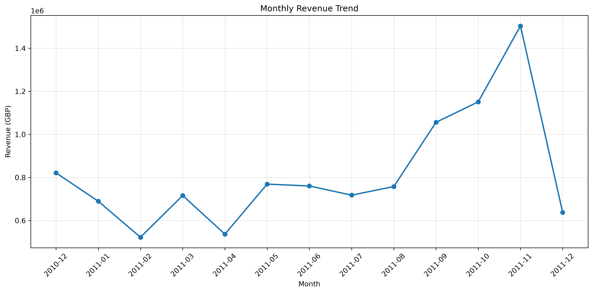
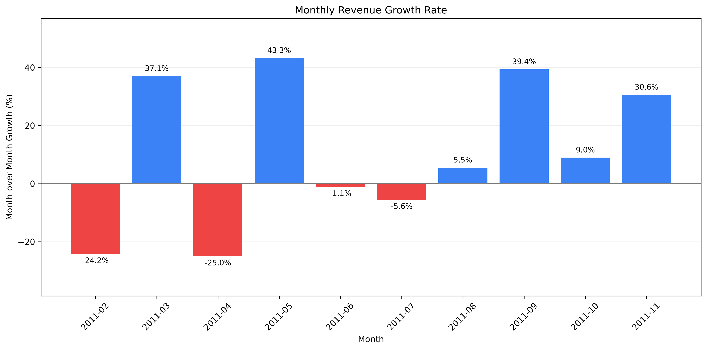
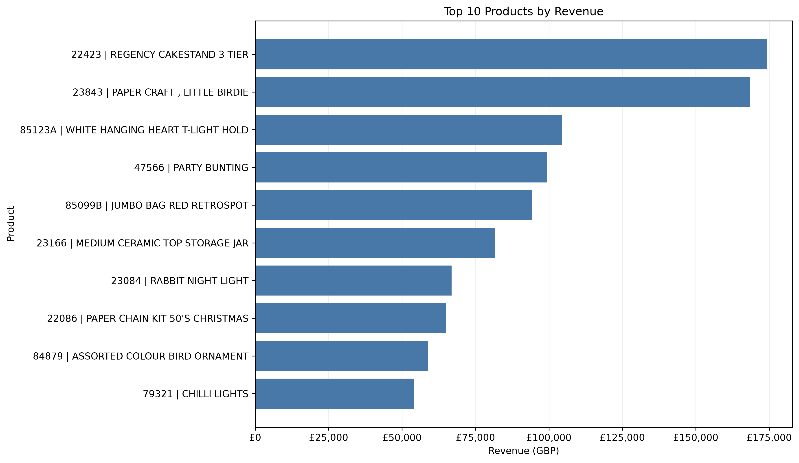
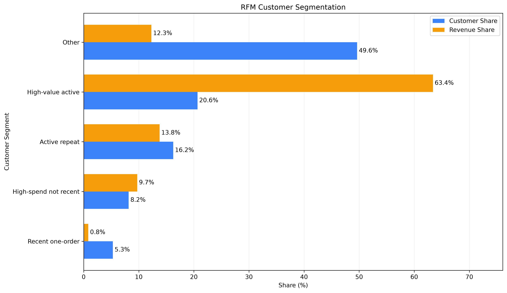

# E-commerce Business Analysis Report

基于 Python、MySQL 与 RFM 模型的电商业务分析报告

## 1. Executive Summary / 执行摘要

This report analyzes 541,909 original transaction records from the UCI Online Retail dataset. Following data cleaning, 524,878 transaction lines were retained for sales analysis.

本报告基于 UCI Online Retail 公开数据集，对英国在线零售商的交易数据进行分析。原始数据包含 541,909 条明细，清洗后保留 524,878 条用于销售分析。

The analysis covers sales performance, monthly growth, product rankings, customer purchasing behavior, and RFM segmentation.

分析重点涵盖销售表现、月度增长、商品销售排名、客户购买行为及 RFM 客户价值分层。

## 2. Business Performance / 核心经营指标

| Metric / 指标 | Value / 数值 |
|---|---:|
| Transaction Lines / 交易明细数 | 524,878 |
| Total Revenue / 正向交易销售额 | £10,642,110.80 |
| Unique Orders / 独立订单数量 | 19,960 |
| Average Order Value / 平均订单金额 | £533.17 |
| Identified Customers / 可识别客户数量 | 4,338 |
| Repeat Customers / 复购客户数量 | 2,845 |
| Repeat Customer Rate / 观察期复购客户占比 | 65.58% |

Revenue represents positive transaction revenue after the project's cleaning rules. It should not be interpreted as net revenue or profit.

销售额按照当前项目的数据清洗规则计算，不代表扣除所有退款、退货和财务调整后的净收入或利润。

## 3. Sales Trend Analysis / 销售趋势分析

Sales revenue increased for three consecutive months from September to November 2011.

2011 年 9 月至 11 月，销售额连续三个月环比增长。

| Month / 月份 | MoM Growth / 环比增长 |
|---|---:|
| September 2011 / 2011年9月 | +39.40% |
| October 2011 / 2011年10月 | +8.98% |
| November 2011 / 2011年11月 | +30.63% |

The results suggest strengthening sales activity toward the end of the observation period. However, a single annual cycle is insufficient to establish a recurring seasonal pattern.

分析结果表明，观察期末的销售活动有所增强，但由于数据仅覆盖约一年，尚不足以证明长期稳定的季节性规律。

**Business Recommendation / 业务建议**

Investigate whether growth was driven by increased order volume, average order value, or specific product categories before making inventory decisions.

建议进一步拆解订单数量、平均订单金额和商品类别贡献，识别增长来源，再制定旺季备货策略。

## 4. Product Performance / 商品销售分析

The highest-revenue product by stock code was REGENCY CAKESTAND 3 TIER, generating £174,156.54 in recorded sales.

按商品编码汇总，REGENCY CAKESTAND 3 TIER 的销售额最高，达到 £174,156.54。

Another product, PAPER CRAFT, LITTLE BIRDIE, generated £168,469.60 from a single transaction line containing 80,995 units.

另一款商品 PAPER CRAFT, LITTLE BIRDIE 的 £168,469.60 销售额全部来自一条购买数量为 80,995 件的交易明细。

Removing this single transaction causes the product to fall out of the top-five revenue ranking.

暂时排除该交易后，这款商品退出销售额前五名，说明商品排名对极端大额交易较为敏感。

**Business Recommendation / 业务建议**

Evaluate product demand using revenue, order frequency, number of purchasing customers, and transaction concentration.

建议结合销售额、订单频率、购买客户数量和大额交易集中度评价商品需求，避免仅根据累计销售额制定补货计划。

## 5. Customer Behavior / 客户购买行为

Among 4,338 identifiable customers, 2,845 placed at least two orders during the observed period, producing a repeat-customer rate of 65.58%.

在 4,338 位可识别客户中，有 2,845 位在观察期内至少购买两次，对应复购客户占比为 65.58%。

This metric reflects observed repeat purchasing among identifiable customers rather than a standardized retention rate.

该指标反映可识别客户在观察期内的重复购买情况，不能直接视为标准化客户留存率。

## 6. RFM Customer Segmentation / RFM 客户价值分层

Customers were segmented using Recency, Frequency, and Monetary indicators.

本项目根据最近购买间隔、订单频率和累计消费金额，将客户划分为五个群体。

| Segment / 客户群体 | Customers / 人数 | Customer Share / 人数占比 | Revenue Share / 销售额贡献占比 |
|---|---:|---:|---:|
| High-value active / 高价值活跃客户 | 896 | 20.65% | 约63.4% |
| Active repeat / 活跃复购客户 | 705 | 16.25% | 约13.8% |
| High-spend not recent / 高消费近期未购客户 | 354 | 8.16% | 约9.7% |
| Recent one-order / 近期单次购买客户 | 230 | 5.30% | 约0.8% |
| Other / 其他客户 | 2,153 | 49.63% | 约12.3% |

High-value active customers account for only 20.65% of identifiable customers but contribute approximately 63.4% of their recorded positive transaction revenue.

高价值活跃客户仅占可识别客户的 20.65%，却贡献约 63.4% 的可识别客户正向交易销售额，体现出明显的客户消费贡献集中现象。

**Business Recommendation / 业务建议**

Prioritize relationship management for high-value active customers, evaluate targeted reactivation for high-spend customers who have not purchased recently, and investigate the broad Other segment before designing campaigns.

建议优先维护高价值活跃客户，对高消费但近期未购买的客户开展针对性唤回评估，并进一步细分占比较高的其他客户群体。

## 7. Data Quality and Validation / 数据质量与结果验证

A cross-tool validation identified a £1,952.48 discrepancy between Pandas and MySQL product-revenue calculations.

在 Python 与 MySQL 交叉验证过程中，发现同一商品编码相关的销售额存在 £1,952.48 差异。

The difference was caused by case-insensitive SQL grouping of StockCode values `85123A` and `85123a`. Applying case-sensitive grouping resolved the inconsistency.

问题源于 MySQL 默认字符串排序规则将大小写不同的商品编码合并统计。通过区分大小写的 SQL 分组规则，最终使两个工具的统计结果保持一致。

This demonstrates the importance of consistent data types, grouping rules, and metric definitions across analytical tools.

该案例说明，在跨工具数据分析中，统一数据类型、分组规则及指标口径对于保证结果一致性非常重要。

### Data Quality Check Results / 数据质量检查结果

The cleaned dataset was validated using SQL to assess missing values, invalid transactions, revenue calculations, date consistency, and duplicate records.

使用 SQL 对清洗后的数据进行质量检查，涵盖缺失值、异常交易、销售额计算、日期一致性及重复记录。

| Check / 检查项目 | Result / 结果 |
|---|---:|
| Total Transaction Lines / 交易明细总数 | 524,878 |
| Missing CustomerID / 客户编号缺失 | 132,186 (25.18%) |
| Missing Descriptions / 商品描述缺失 | 0 |
| Invalid Quantities / 非正数购买数量 | 0 |
| Invalid Prices / 非正数商品价格 | 0 |
| Revenue Calculation Mismatches / 销售额计算不一致 | 0 |
| Date Mismatches / 日期不一致 | 0 |
| Exact Duplicate Groups / 完全重复记录组合 | 0 |
| Extra Duplicate Rows / 多余重复记录 | 0 |

The validation found no invalid quantities, invalid prices, revenue calculation mismatches, date mismatches, or exact duplicates under the defined comparison rules.

按照本项目的检查规则，未发现非正数数量、非正数价格、销售额计算不一致、日期不一致或完全重复记录。

However, 25.18% of transaction lines have missing CustomerID values. These records were retained for overall sales analysis but excluded from customer-level analysis.

但是，25.18% 的交易明细缺少客户编号。这些记录仍用于整体销售分析，但不参与客户级别的行为分析。

All six baseline business metrics passed automated SQL validation.

六项核心业务指标均通过 SQL 自动化基准验证。

## 8. Limitations / 分析局限性

The dataset does not contain browsing, add-to-cart, or other website interaction events.

数据集不包含浏览、加购等网站行为事件，因此不能分析完整的用户访问转化漏斗。

Missing CustomerID values limit customer-level analysis coverage.

部分交易缺少客户编号，限制了客户行为分析的覆盖范围。

Returns, refunds, and financial adjustments have not been fully reconciled.

本项目尚未完整核算退货、退款及各类财务调整，因此不能直接计算企业净收入。

December 2011 contains incomplete monthly data.

2011 年 12 月数据覆盖不完整，不适合直接与完整月份比较销售总额。

RFM segmentation uses exploratory scoring rules rather than a validated production customer model.

RFM 客户分层采用探索性评分规则，尚未经过实际营销效果验证。

## 9. Conclusion / 分析总结

The analysis demonstrates how Python, MySQL, statistical summaries, and customer segmentation can be combined to identify business patterns and data-quality risks.

本项目展示了如何结合 Python、MySQL、统计分析和客户分层方法，从真实交易数据中识别经营趋势、客户价值差异及数据质量问题。

The main findings highlight concentrated customer spending, year-end sales growth, and the influence of unusually large transactions on product rankings.

主要发现包括高价值客户消费贡献集中、观察期末销售额持续增长，以及极端大额交易对商品排行榜产生显著影响。

Future improvements should focus on return-adjusted financial metrics, customer cohort analysis, refined customer segmentation, and reproducible reporting.

后续可以进一步研究扣除退货后的销售指标、客户同期群分析、客户分层规则优化和自动化报告生成。